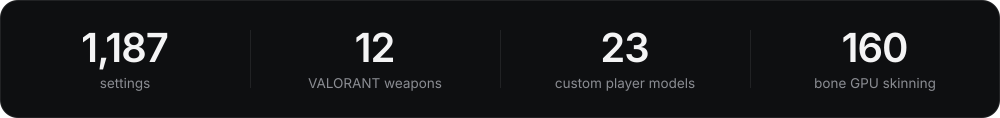
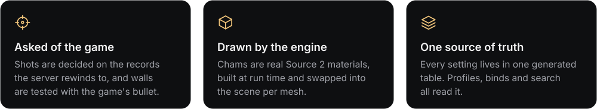
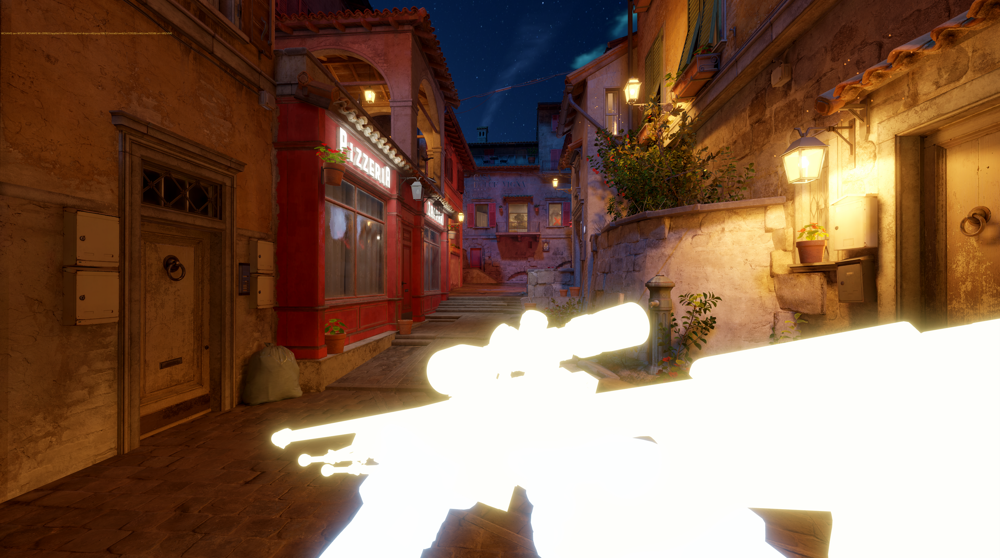
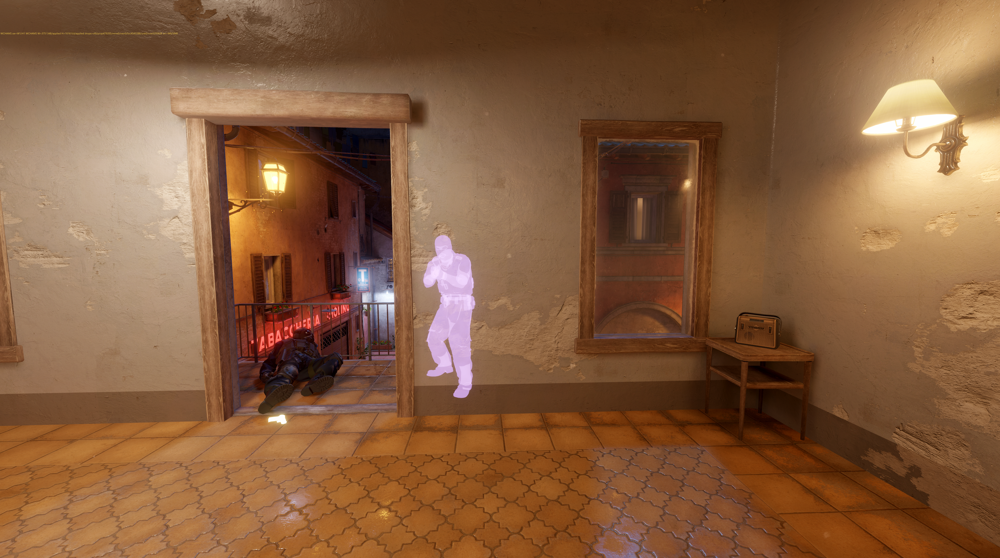
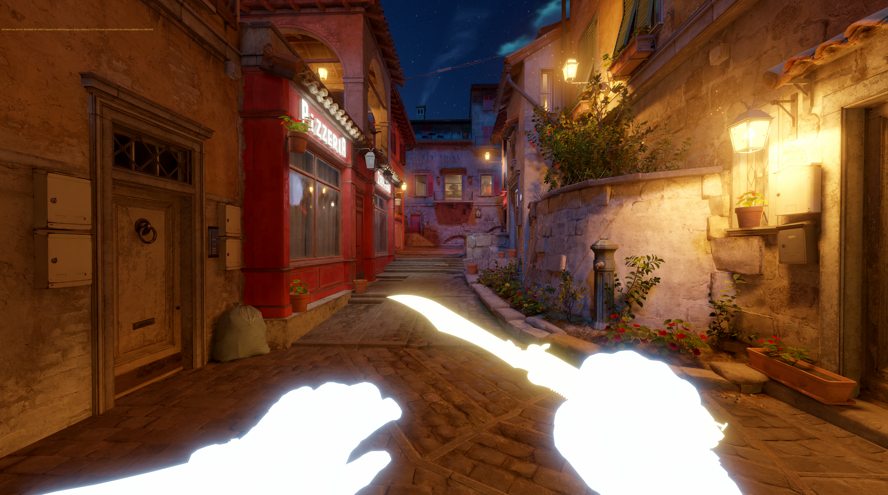
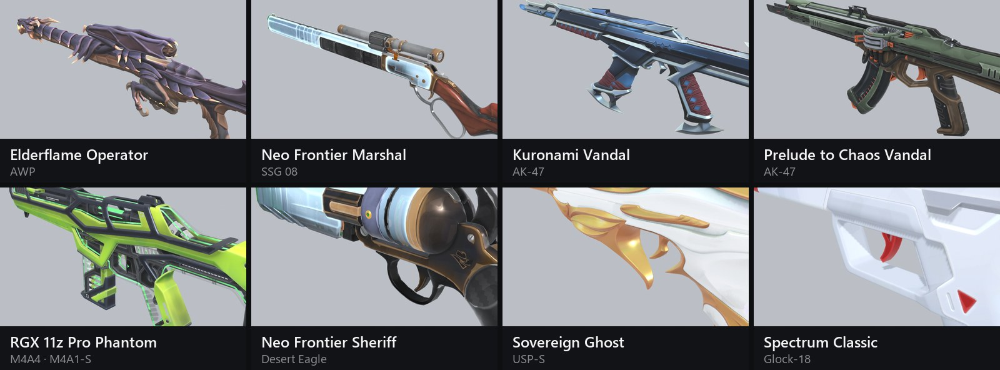
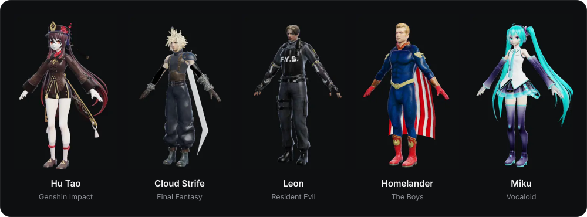
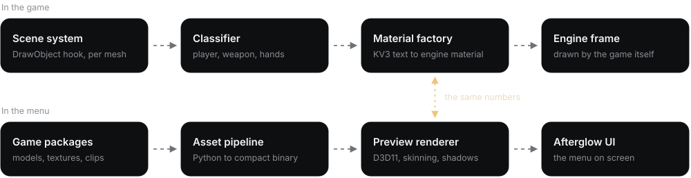

  

  

<a href="#overview">Overview</a> &nbsp;·&nbsp;
<a href="#ragebot">Ragebot</a> &nbsp;·&nbsp;
<a href="#anti-aim">Anti-aim</a> &nbsp;·&nbsp;
<a href="#visuals">Visuals</a> &nbsp;·&nbsp;
<a href="#models">Models</a> &nbsp;·&nbsp;
<a href="#interface">Interface</a> &nbsp;·&nbsp;
<a href="#engineering">Engineering</a> &nbsp;·&nbsp;
<a href="#changelog">Changelog</a>

  

  

## Overview

**Belenus** is a Counter-Strike 2 internal built for HvH community servers, written from scratch in C++20. It is one DLL that hooks the renderer, the scene system and the command pipeline, draws its own interface, and changes what the engine renders instead of painting over it.

It works by asking the game rather than modelling it. Shots are decided on the records the server will rewind to. Walls are tested with the game's own bullet, and spread is solved from the game's own seed. Where the client could not answer a question, the answer was read out of the server binary before any code was written against it.

## Ragebot

<table>
<tr><td width="170"><b>Lag compensation</b></td><td>Targets are scanned where the server will put them: tick-exact record stamps, the client's interpolation ratio and the <code>sv_maxunlag</code> window. On high ping, motion is carried past the newest record.</td></tr>
<tr><td width="170"><b>Penetration</b></td><td>Hidden points go to the game's own bullet in the same tick. A pass over the map's geometry first drops the lines that cannot get through. Armour and helmet are applied to the damage.</td></tr>
<tr><td width="170"><b>Hit chance</b></td><td>Measured against the weapon's real inaccuracy, with the client's own terms for movement, turning and the top of a jump.</td></tr>
<tr><td width="170"><b>No spread</b></td><td>On seed-synchronised servers the round's spread is solved and cancelled, and the shot leaves on the first ready tick.</td></tr>
<tr><td width="170"><b>Point selection</b></td><td>Head first, with multipoints that stay on the visible side of a bowed head. The body is the fallback, under minimum damage and minimum chance. Each weapon class has its own hit groups, head and body scale, and safe point.</td></tr>
<tr><td width="170"><b>Firing</b></td><td>Silent aim, auto shoot, auto scope and stop, backtrack and on-shot timing. CS2's command queue rules out a classic double tap, so Belenus fires a legal second round on guns that cycle fast enough.</td></tr>
<tr><td width="170"><b>Legit</b></td><td>Aim assist with FOV, speed and per-axis smoothing, a trigger with delay and reaction time, and recoil control.</td></tr>
</table>

## Anti-aim

- **Per state.** Standing, moving, airborne and crouched each have their own pitch, yaw base, yaw mode, offset, jitter and spin.
- **Threat model.** The back turns to whoever can actually see you, found by a line of sight through the map from their eye to yours. Fresh peeks, height and recent shots raise a player's weight, and the choice is held so it does not flicker between two players.
- **Shooter tracking.** Enemy bullet impacts that pass close to you mark the player who fired them.
- **Freestanding.** While peeking, the head stays toward the wall.
- **Hide shots.** Firing commands keep the fake in the base angle.
- **Rapid duck** on a key.

## Movement

- Bunny hop, fast start and auto strafe
- Subtick air movement, on servers that take unquantised input
- Quick stop and slow walk
- Quick peek: the moment the round leaves, you are walked back to where you started
- Third person, camera FOV and viewmodel offsets

## Visuals

<kbd></kbd>

  

### Players

Chams are built from the agent's own material at run time, so its normals and occlusion survive.

- Solid, ghost, metal and glow looks, plus custom looks from a layered material editor
- A through-wall layer in its own colour and opacity
- Backtrack records drawn as a skeleton or a head line
- Glow and bloom
- ESP: boxes, health, names, weapon and ammo, skeleton, snaplines, off-screen arrows, dormant fade
- Flags: armour, scoped, flashed, reloading, bomb, kit, money, lethal, hit chance

 

### Hands and weapon

- Players, weapon and hands are three separate materials
- Each with its own look, colour, opacity, brightness and glow
- Previewed in first person on the real viewmodel, inside the menu
- Applies to the gun in your hands, guns in the world, or only your own

 

### HUD

- Hitmarkers on screen and in the world, damage numbers, hit counter, hit sounds with custom `.wav` support
- Bullet tracers from the muzzle, a penetration crosshair, indicators
- A hit log and feature toggles in the style of the kill feed

### World

- **Removals.** Scope, flash, smoke and fog removal; smoke and molotov areas; grenade path prediction.
- **Atmosphere.** Lighting, sky presets, clouds and lightning, haze, wet ground.
- **Weather.** Rain, heavy rain, snow, ash, embers, dust and neon rain. The wind moves the trees, and rain and thunder use the game's own recordings.
- **Film.** Exposure, contrast, warmth, bloom, sun shafts, vignette and grain.
- **Round finale.** A cinematic end of round with its own camera, colour grade and title.

## Models

### VALORANT weapons

Twelve VALORANT weapons replace their CS2 counterparts in first person. Each keeps its own animations: draw, inspect and, for guns, reload and fire. VALORANT's hands are retargeted bone by bone onto CS2's arms, and the skin keeps its effects and sounds where the export carries them.

| CS2 | VALORANT |
|---|---|
| AK-47 | Elderflame Vandal · Kuronami Vandal · Prelude to Chaos Vandal |
| M4A4 · M4A1-S | RGX 11z Pro Phantom |
| AWP | Elderflame Operator |
| SSG 08 | Neo Frontier Marshal |
| Desert Eagle | Neo Frontier Sheriff |
| Glock-18 | Spectrum Classic |
| USP-S | Sovereign Ghost |
| Karambit | RGX 11z Pro Karambit |
| M9 Bayonet | Onimaru Kunitsuna (Tsubame), drawn from its scabbard |

### Player models

23 custom characters are fitted to CS2's skeleton and driven by the game's own animations. They sit alongside the stock agents, and each is chosen from a list with a live 3D preview.

### Skins

CS2 weapon finishes with wear, seed and StatTrak.

## Interface

The menu runs on **Afterglow**, a UI kit written for this project on raw ImGui draw lists. It has its own layout engine, type scale, animation system and DPI handling, and none of its widgets are stock.

- **A scene behind the pages.** A real map with baked lightmaps, the agent and the first-person weapon. It uses GPU skinning up to 160 bones, shadow maps, depth of field and bloom. Chams and models are previewed the way the game will draw them.
- **Grouped cards.** Pages and rows animate in, and the game shows through blurred and darkened behind the window.
- **Search, binds and configs.** Every row is searchable, any toggle can be bound, and saved configs can be imported and exported through the clipboard.
- **Tunable look.** Size, accent, transparency, background blur and animation speed are all settings.

## Engineering

  

- **Server-side research.** Lag-compensation rewind, the command queue, the fire gate and the jump rule were read out of `server.dll` before the client was written against them.
- **Measured, not guessed.** Tagged runtime logs record impacts, lag records, threat changes and misses. Each aim change is judged against the next session's numbers.
- **Generated configuration.** 1,187 settings across 40 headers are collected into one table at build time. Profiles, binds, search and migration between versions all read it, so a new slider cannot go unsaved.
- **Runtime resources.** Compiled models are registered with the engine's file system while the game runs. They are re-registered on map changes, gated on the connection state.
- **Asset pipeline.** Python and Blender tooling exports VALORANT models, materials and animations, and retargets the hands through bone frames built from the anatomy. The game's own resource compiler compiles the result.
- **Offline UI harness.** The interface builds and runs outside the game, and one command renders any page, tab or animation frame to PNG. Every menu image on this page was made that way.

## Changelog

#### October 2026

- Ragebot rebuilt around tick-exact lag compensation and same-tick game bullets
- No-spread compensation; the first shot leaves without delay on seed-synchronised servers
- Head-first multipoint; per-weapon hit groups, head and body scale
- Anti-aim per movement state, threat-aware yaw, freestanding, shooter tracking
- High-ping extrapolation and a view of the backtrack records
- Subtick air movement, quick peek, rapid duck
- Twelve VALORANT weapons with their own animations, most recently the Onimaru Kunitsuna and its scabbard
- Models page as a picture grid; custom models survive map changes
- Menu redesign: grouped cards, animations, background blur, a look the owner can tune
- World: weather with wind and sound, film grade, sky and lightning, wet ground, round finale

#### Early October 2026

- Chams rebuilt on the agent's own material; players, weapon and hands are independent
- Through-wall rendering in its own colour and opacity
- Menu scene with the weapon and hands in first person
- Hitmarkers on the point that was hit, tracers from the muzzle

 

Source is private. This repository is a showcase. Not affiliated with Valve or Riot Games. Counter-Strike and VALORANT assets belong to their owners.

